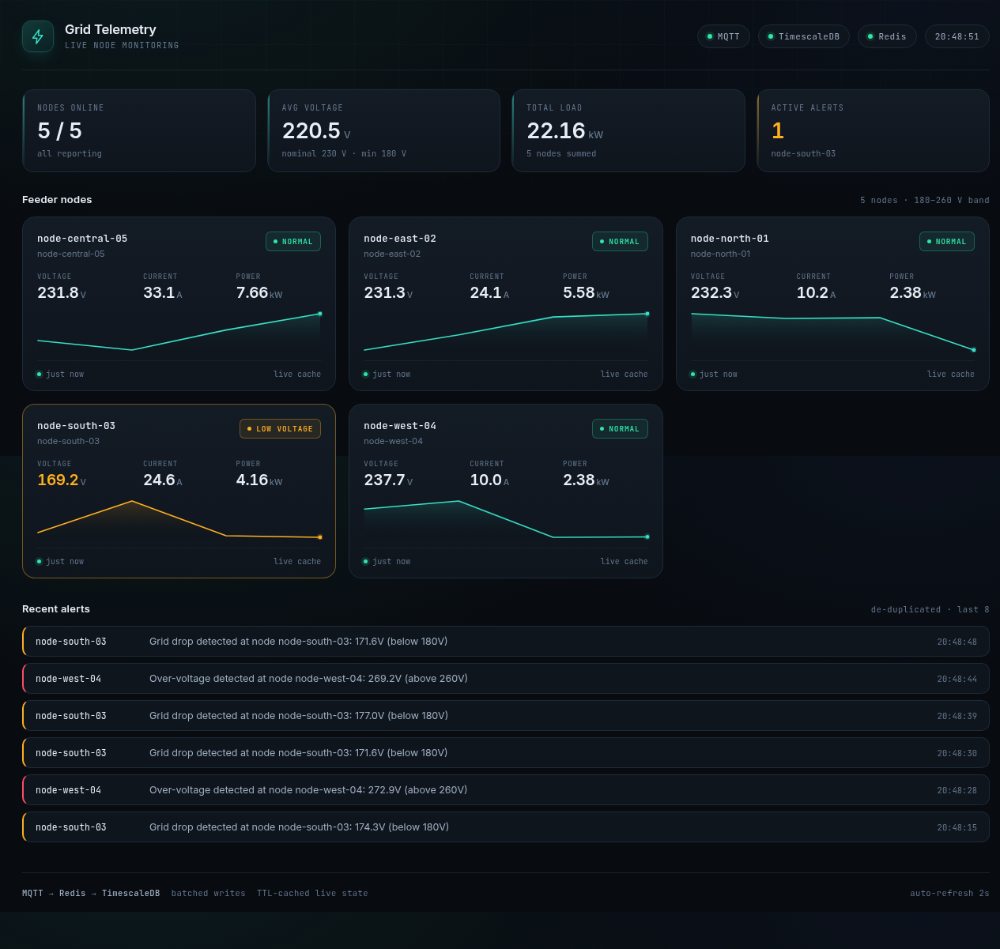

# IoT Grid Telemetry

A production-shaped telemetry pipeline for electrical grid monitoring: MQTT
devices publish voltage/current readings, the service validates and caches
them, batches them into a time-series database, raises de-duplicated alerts,
and serves a live dashboard.

**▶ Live dashboard demo:** https://ebubechineka.github.io/iot-grid-telemetry/
*(a replay of a real capture — the same UI, fed from a frozen snapshot)*



```
  ┌──────────┐   MQTT    ┌──────────────┐   HSET+TTL   ┌─────────┐
  │  Nodes   │──────────▶│  Ingestion   │─────────────▶│  Redis  │
  │ (devices)│  grid/+/  │    Core      │              │ (live)  │
  └──────────┘ telemetry └──────┬───────┘              └────┬────┘
                                │ batched INSERT            │ read
                                ▼                           │
                         ┌──────────────┐                   │
                         │ TimescaleDB  │◀──────────────────┤
                         │  (history)   │                   │
                         └──────┬───────┘                   │
                                │                           │
                                ▼                           ▼
                         ┌────────────────────────────────────┐
                         │   Fastify API  +  Live Dashboard   │
                         └────────────────────────────────────┘
```

---

## Quick start

### Option A — Docker (everything, one command)

```bash
cp .env.example .env
docker compose up -d --build

# apply the schema (also runs automatically on a fresh volume)
docker compose run --rm app npm run migrate

# publish fake telemetry
docker compose run --rm app npm run simulate
```

Open **http://localhost:3000**.

### Option B — Local services

Requires Node 20+, PostgreSQL 13+ (TimescaleDB optional), Redis 6+, Mosquitto.

```bash
cp .env.example .env          # edit DATABASE_URL if needed
npm install
npm run migrate               # creates tables, indexes, hypertable
npm run start                 # API + dashboard on :3000
npm run simulate              # in a second terminal
```

Open **http://localhost:3000**.

### Verify it's working

```bash
curl localhost:3000/health          # postgres/redis/mqtt all "up"
curl localhost:3000/api/nodes       # 5 nodes with live readings
redis-cli --scan --pattern 'node:live:*'
psql "$DATABASE_URL" -c "SELECT count(*) FROM grid_telemetry_logs;"
```

---

## What was wrong with the original code

The starting snippet was a working sketch, but it had eight problems that
would each have caused an incident in production. Every one is fixed here.

| # | Original | Problem | Fix |
|---|---|---|---|
| 1 | `new Client(...)` + one `.connect()` | One connection for the whole process. Every insert queues behind the last; a dropped connection kills the service until restart. | `pg.Pool` with `max`, timeouts, and an `error` handler so idle-client failures don't crash the process. |
| 2 | `JSON.parse` then trust | A malformed message throws deep in the insert path, or writes `NaN`/strings into the time-series table. | Zod schema: `nodeId` charset + length, finite voltage/current in plausible ranges, epoch-ms timestamp not in the future. |
| 3 | Topic never validated | A device publishing to `grid/node-a/telemetry` with `nodeId: "node-b"` writes under another node's identity. | Topic regex **and** a topic↔body identity check. Mismatches are rejected and counted. |
| 4 | `hmset` with no expiry | A node that dies keeps showing its last voltage forever. | `HSET` + `EXPIRE` in one pipeline; `REDIS_LIVE_TTL_SECONDS` (default 120s). Stale nodes are labelled, not silently frozen. |
| 5 | One `INSERT` per message | Hundreds of round trips per second; the event loop lives in `await`. | In-memory buffer flushed on `BATCH_MAX_ROWS` **or** every `BATCH_FLUSH_INTERVAL_MS` — one multi-row `INSERT` per flush. |
| 6 | No reconnect handling | MQTT/Redis/Postgres blips are fatal. | Reconnect strategies on all three, plus graceful `SIGINT`/`SIGTERM` shutdown that drains the buffer before exiting. |
| 7 | No duplicate/ordering guard | A device replaying its buffer after reconnect double-writes, and late messages corrupt the series. | Two layers: in-memory `lastTimestampByNode` (strictly-increasing) **and** `UNIQUE (node_id, logged_at)` + `ON CONFLICT DO NOTHING`. |
| 8 | `180` hard-coded, `console.warn` per message | Retuning needs a deploy; a node at 175V for 10 min emits 600 identical warnings. | All thresholds in env. Alerts de-duplicated per `(node, kind)` for `ALERT_DEDUPE_WINDOW_SECONDS`, persisted to `grid_alerts`, and cleared when the node returns to band. |

Also removed: the unused `syslog` import. Replaced `console.*` with `pino`
structured logging (JSON in production, pretty in dev, secrets redacted).

---

## Project layout

```
src/
  config.ts       env schema (zod) — every tunable, validated at boot
  logger.ts       pino, pretty in dev / JSON in prod
  db.ts           pg Pool + health check
  redis.ts        ioredis, live-key helpers, TTL writes
  validation.ts   topic + payload contracts
  writer.ts       batched, de-duplicated writer with back-pressure
  alerts.ts       threshold evaluation + de-duplication
  ingestor.ts     MQTT consumer wiring it all together
  api.ts          Fastify routes
  server.ts       boot order + graceful shutdown
  simulator.ts    fake grid nodes for demos
  migrate.ts      forward-only SQL migration runner
sql/001_init.sql  schema, indexes, hypertable, retention, rollups
public/index.html live dashboard (no build step, no framework)
docker/           mosquitto config
```

---

## API

| Method | Path | Description |
|---|---|---|
| `GET` | `/` | Live dashboard |
| `GET` | `/health` | Postgres/Redis/MQTT status + pipeline counters |
| `GET` | `/api/nodes` | Every node with its latest reading, status and age |
| `GET` | `/api/nodes/:nodeId/history?limit=120&minutes=60` | Time-ordered history for one node |
| `GET` | `/api/alerts?limit=20` | Recent de-duplicated alerts |

`/api/nodes` response:

```json
{
  "count": 5,
  "thresholds": { "voltageMin": 180, "voltageMax": 260, "staleAfterSeconds": 120 },
  "nodes": [
    {
      "nodeId": "node-north-01",
      "label": "node-north-01",
      "voltage": 234.4,
      "currentAmps": 11.02,
      "powerWatts": 2583.1,
      "status": "normal",
      "ageSeconds": 1,
      "loggedAt": "2026-11-09T20:48:28.167Z",
      "live": true
    }
  ]
}
```

`status` is one of `normal` · `low_voltage` · `over_voltage` · `stale`.

---

## Message contract

Topic: `grid/<nodeId>/telemetry` — `nodeId` matches `[A-Za-z0-9._:-]{1,64}`.

```json
{
  "nodeId": "node-north-01",
  "voltage": 231.4,
  "currentAmps": 12.1,
  "timestamp": 1794257308167
}
```

`timestamp` is **epoch milliseconds**. Anything before 2001 or more than
5 minutes in the future is rejected as a clock bug.

---

## Configuration

Everything lives in `.env` (see `.env.example`). The ones you'll actually touch:

| Variable | Default | Meaning |
|---|---|---|
| `DATABASE_URL` | — | **Required.** Postgres connection string |
| `REDIS_URL` | `redis://127.0.0.1:6379` | Live cache |
| `MQTT_BROKER_URL` | `mqtt://127.0.0.1:1883` | Broker |
| `MQTT_TOPIC` | `grid/+/telemetry` | Subscription filter |
| `ALERT_VOLTAGE_MIN` | `180` | Low-voltage threshold (V) |
| `ALERT_VOLTAGE_MAX` | `260` | Over-voltage threshold (V) |
| `ALERT_DEDUPE_WINDOW_SECONDS` | `300` | Alert suppression window |
| `REDIS_LIVE_TTL_SECONDS` | `120` | Live reading lifetime |
| `BATCH_MAX_ROWS` | `500` | Flush when the buffer hits this |
| `BATCH_FLUSH_INTERVAL_MS` | `1000` | …or every this many ms |
| `API_STALE_AFTER_SECONDS` | `120` | When a node is reported stale |

---

## Simulator

Five fake feeders with distinct personalities, so every code path is
exercised without hardware:

| Node | Behaviour |
|---|---|
| `node-north-01` | Healthy, steady ~231 V |
| `node-east-02` | Healthy, heavier load (~25 A) |
| `node-south-03` | Periodic sags into low-voltage alerts |
| `node-west-04` | Occasional over-voltage spikes |
| `node-central-05` | Goes offline for stretches, then returns |

```bash
npm run simulate                    # 1 msg/sec per node, forever
npm run simulate -- --rate 4        # 4 msg/sec per node
npm run simulate -- --duration 60   # stop after 60s
```

---

## TimescaleDB

The schema upgrades itself when the extension is present:

- `grid_telemetry_logs` becomes a **hypertable** (1-day chunks)
- **90-day retention policy**
- `grid_telemetry_1m` **continuous aggregate** — per-minute avg/min/max voltage,
  avg current, avg power, sample count

On plain PostgreSQL all three steps are skipped with a `NOTICE` and the table
works normally, backed by a `BRIN` index on `logged_at` (tiny, and ideal for
append-only time data). This is why the project runs on a stock Postgres
image as well as the TimescaleDB one.

---

## Operational notes

- **Back-pressure:** if Postgres is unreachable, the buffer is capped at
  `BATCH_MAX_BUFFER`. Beyond that the *oldest* readings are dropped and a
  warning is logged — the newest data is the most useful.
- **Failed flush:** the batch is requeued at the front, so a transient DB
  error loses nothing.
- **Shutdown:** `SIGINT`/`SIGTERM` stops MQTT first, drains the buffer (up to
  3 attempts), then closes HTTP, Redis and Postgres. A 15s hard timeout
  prevents a wedged socket from hanging the process.
- **Health:** `/health` returns `503` when any dependency is down, so a
  container orchestrator can act on it.

---

## License

MIT
